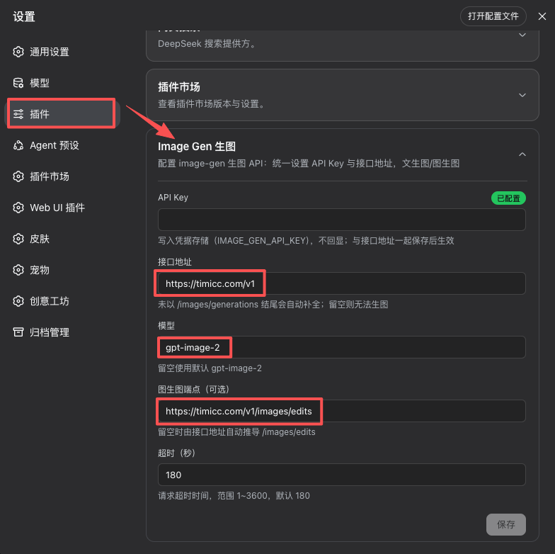
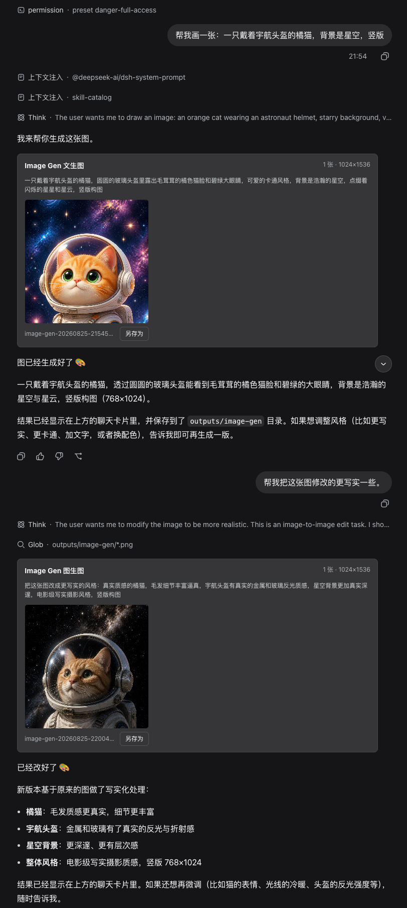

# DSH Image Gen

Adds `gpt-image-2` generation to DeepSeek Harness by calling any third-party
**OpenAI Images compatible endpoint**. Fill in `baseURL` and `API Key` and use
text-to-image and image-to-image tools directly in conversation.

[中文](./README.zh-CN.md)

> This plugin is a rewritten, fixed fork of
> [dsh-image2-draw](https://github.com/JuneLearn/dsh-image2-draw.git). It fixes a
> load-time bug that broke the original (see "Bug fix" below).

## Compatibility

- Requires **DeepSeek Harness 0.2.1-rc.2** (peer dependencies are pinned to
  `@deepseek-ai/dsh-attachment` / `dsh-credentials` / `dsh-settings` / `dsh-tools`
  `0.2.1-rc.2`, cordis `~4.0.5`).
- v0.2.0 migrates to the 0.2.1-rc.2 plugin APIs: settings are projected from a
  top-level `Config` schema (volatile fields), the config page registers through
  the `plugins.row.config` slot, and credentials go through the new
  `remote.credentials` RPC. The removed `settings.plugin.item` slot,
  `installSettingsSection`, and `dsh-client-runtime` inject are no longer used.

## Features

- A dedicated **Image Gen** config page under
  **Plugins → Installed plugins → dsh-image-gen → Config** (the `image-gen` row).
- Only `baseURL` and `API Key` are required; the default model is `gpt-image-2`.
- `baseURL` accepts shorthands like `https://example.com/v1`; the plugin appends
  `/images/generations` automatically.
- The edit endpoint defaults to `/images/edits` derived from `baseURL`, or can be
  set explicitly via `editURL`.
- `image-generate` (text-to-image) tool, generating 1–8 images sequentially.
- `image-edit` (image-to-image) tool with 1–8 PNG / JPEG / WebP reference images.
- Adaptive portrait / landscape / square sizes, plus validated custom sizes.
- Result display follows the same mechanism as
  [dsh-image2-tool](https://github.com/544244857/dsh-image2-plugin): the result
  text carries the saved relative path (`outputs/image-gen/…`), the model is
  instructed to inspect the output with the built-in `read_image` (DSH's
  built-in image card) and append a markdown link to the result image —
  clicking it previews the image in the sidebar. No session attachments, no
  custom image view, no inline preview dependency.
- Images are also written to `outputs/image-gen/` in the session working directory
  (auto-numbered, never overwriting existing files).
- API Key is written only to DSH credentials (default ref `IMAGE_GEN_API_KEY`); it is
  never echoed or stored in the settings document.
- Validates config writes, response sizes, timeouts, and reference files; 524/timeout
  is not auto-retried to avoid duplicate billing.

## Install

### Prerequisites

- [Node.js](https://nodejs.org/) (24 LTS recommended).
- [Git](https://git-scm.com/).
- [pnpm](https://pnpm.io/installation).

### Via npx

```bash
npx --yes -p @deepseek-ai/dsh dsh plugin --profile web add github:vip164/dsh-image-gen
npx --yes -p @deepseek-ai/dsh dsh web
```

Pin a release with `github:vip164/dsh-image-gen#v0.2.0`.

### Via pnpm + Harness source

```bash
cd <deepseek-harness>
pnpm dsh plugin --profile web add github:vip164/dsh-image-gen
pnpm dsh web
```

## Configuration

1. Open **Plugins → Installed plugins → dsh-image-gen** and choose **Config** on the
   `image-gen` row.
2. Fill in **Endpoint (baseURL)**, e.g. `https://example.com/v1`.
3. Fill in **API Key** (stored in credentials, default ref `IMAGE_GEN_API_KEY`).
4. Optionally adjust **Model** (default `gpt-image-2`), **Edit endpoint**, or **Timeout**.
5. Save, then use `image-generate` / `image-edit` in conversation.



## Use Case


## Development

```bash
pnpm test   # pure-function unit tests (no DSH boot required)
```

Layout:

- `lib/index.js` — Host half: top-level `Config` schema (volatile fields project the
  settings form), `image-gen` settings namespace, `image-generate` / `image-edit`
  tools, `/image-gen/*` HTTP routes.
- `lib/client.js` — Browser half: `plugins.row.config` config page only (key
  `dsh-image-gen#image-gen`); result images render through the built-in
  `read_image` card.
- `cordis.patch.yml` — mounts both halves (entry id `image-gen`) plus the bundled
  inline media viewer (entry id `inline-media`).

## License

[MIT](./LICENSE)
